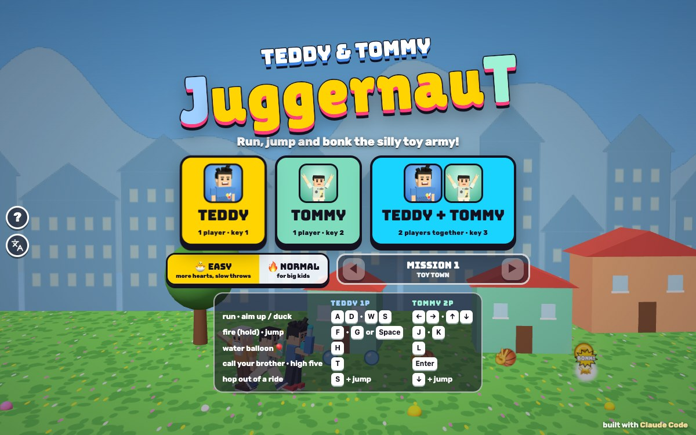

# JuggernauT

[](https://adong.github.io/juggernaut/)

Press **?** any time (or tap the round **?** button on the left edge) to see the keys. The game waits while you look.

Tap the language button under it (the A文 icon) to switch between English and 中文; the dashboard and every game remember the choice.

A classic run-and-gun for Teddy and Tommy, the kind Dad played in the arcade, made for small hands and best played together. It's built with Claude Code from plain JavaScript and Three.js, on the shared Claude Games kit.
The brothers run left to right through six missions, jump, shoot in eight directions, hop into silly rides, free tied-up friends and bonk a goofy toy army, with a cartoon boss at the end of each mission.
There are no image, model or audio files: the brothers, baddies, rides and places are built from boxes and balls, every texture is painted on a canvas, and every sound is synthesised.
It's silly, never war-like: Teddy fires 🏀 basketballs and Tommy fires ✌️ peace stars, the specials are water balloons, and the baddies go BONK! and pop into treats, coins and stars. Nobody gets hurt: you get bonked and lose a heart.

The name is Alan's: **JuggernauT**, with a capital J and a capital T at the end. It lives in one constant, `JUG.TITLE` in `js/title.js`, and the page title, logo (J in Teddy's blue, T in Tommy's mint) and ? panel all follow it.

## Play

- **Double-click `index.html`.** It works offline because Three.js and the kit are copied into `kit/`. Without internet the fonts fall back to Arial Black.
- **Send one file:** `dist/juggernaut.html` is the whole game in one page (about 960 KB). AirDrop or email it, then open it in a browser.
- Rebuild that file after any edit: `python3 kit/tools/bundle.py . --name juggernaut`

On the title screen, tap your face to play alone (**TEDDY** or **TOMMY**), or tap **TEDDY + TOMMY** for two players on one keyboard or one iPad. Pick 🐣 **EASY** (the default) or 🔥 **NORMAL**, and any mission you've reached.

## Controls

| | Teddy (1P) | Tommy (2P) | Touch |
|---|---|---|---|
| run | A D | ← → | the pad |
| aim up · duck (aim down in the air) | W · S | ↑ · ↓ | push the pad up · down |
| fire (hold it) | F | J | by itself |
| jump | G or Space | K | ⬆️ |
| water balloon 🎈 (tank: cannon, Boing Bot: ground pound) | H | L | 🎈 |
| hop out of a ride (bail out when it smokes) | S + jump | ↓ + jump | pad down + ⬆️ |
| call your brother (1 player) · high five (2 players) | T | Enter | his face |
| pause · sound | P or Esc · M | | ❚❚ · 🔊 at the top |

- **Shooting in 8 directions:** hold up to aim up, up + left or right to aim diagonally. In the air, down aims down (and down-diagonally). On the ground, down ducks: you shoot low and the shots fly over you.
- **Playing alone**, both key sets work, so the arrows and J K L work too.
- **Touch:** the pad on the left runs and aims, and your blaster fires by itself whenever there's something to bonk. On a touch screen the ground sits a little higher, so the buttons never cover the brothers.
- **Two players on an iPad:** Teddy has a pad and buttons on the left, Tommy on the right, and the high-five button sits at the top in the middle.
- **Title screen keys:** 1 plays Teddy, 2 Tommy, 3 both, E toggles easy, ← → (or < >) pick the mission, and Enter plays again.

## How it works

- **The screen scrolls** as you run right. Now and then it **stops for a fight**: the baddies come from both sides, and when they're all bonked a big **GO! ➜** sends you on. Each mission ends in a boss arena.
- **Blasters:** Teddy's own is 🏀 basketballs, Tommy's is ✌️ peace stars. Friends and crates give you more, which run out after a while:
  - 💦 **WATER BLASTER:** a fast stream.
  - 🫧 **BUBBLE GUN:** three bubbles at once.
  - ☁️ **MEGA FOAM CANNON:** big foam blobs that steer a little and go SPLASH.
  - ❄️ **SNOWBALL LAUNCHER:** a short-range burst of snowballs that chills baddies.
- **Water balloons 🎈** are the specials: a lob ahead (higher when you aim up) that splashes everything near. You start with 15 on Easy, 10 on Normal.
- **The toy army and friends:** wind-up guys in party hats (corks), pie drummers (lobbed pies), bloop bots, propeller grumps that drop water from above, sleepy zombies and zombie farmers (they bite), grumpy crabs, mummies (dust), banana-ray bots, grumpy snow pups (ice) and crates to crack open. Every one winds up with a big **❗** before it throws, and their throws are big, round and outlined so they show on any ground. Your shots can pop pies, corks, goo and dust in the air.
- **Getting bonked:** you lose a heart and blink for a moment (3 s on Easy, 2 s on Normal). Hearts: 6 on Easy (up to 8), 4 on Normal (up to 6). Bonked baddies leave coins, stars and treats; ❤️ hearts come from friends and crates.
- **TRY AGAIN** starts you at the last fight (or the boss), with full hearts.

### Rides

Walk (or jump) into a ride to climb in. While you ride, the ride takes the bonks, not you. When it's about to break it smokes and blinks and a **BAIL OUT!** warning pops up: hop out (down + jump) and it rolls on by itself into the baddies for a **MEGA BONK!** If it breaks with you inside, it goes KA-POOF and pops you out safely, without losing a heart.

- **TT TANK:** a chubby blue toy tank with googly headlights and TT on the side. Its bubble gun turns to aim in all eight directions, the 🎈 key fires its cannon (🏀 shells; water balloons give it more), and down makes it squat.
- **LOLLY THE LLAMA:** a fluffy llama with a bubble blaster on her saddle. Fast, and she jumps high.
- **BOING BOT:** a red mech on springy legs with foam boxing-glove fists. Big bouncy jumps, and the 🎈 key is a **ground pound** that bonks everything around it.

### The cast

- **The Fuzzbeards:** bearded friends tied up with gift ribbon. Shoot the ribbon or run into them: FREE! They jump up, bring you a present (a blaster, balloons, a heart, a potion, or Coco), salute, and run off home.
- **Bruno's balloon drop:** Bruno the bear (from the kit) floats down under a bunch of balloons and drops a crate.
- **Coco the monkey:** a little monkey with a water blaster who fights next to you for half a minute, then waves goodbye.
- **Villagers and farmers** cheer and wave as you run past; **camels** chew in the desert; **birds** flutter off when you get close.
- **The bosses:** **KING CRANKY** (a giant tin wind-up king: cork volleys, stomps that send a wave along the ground, more wind-up guys), **CAPTAIN CRABCAKE** (bubbles, a claw snap and a big leap with a red landing mark), **KING WRAPPY** (a sleepy mummy on a floating throne: mummy dust and a bandage whip), **BIG BANANA BOT** (a banana blimp: banana-ray beams with a dashed warning first, and banana bombs), **FREEZE-POP KING** (a giant snowman on a sled: ice, a rolling snowball to jump, and icicles that show their shadow first) and **ZOMBIE ZORG** (a giant zombie in a crown on a toy castle: goo and stomps, then dust and ice too). They rest, wind up so you can see what's coming, then do it.

## Call your brother (companion mode)

Playing alone, press **T** or tap his face (bottom right) to call the other brother, any time and as often as you like (`Kit.roster.buddyFor(id)`: Tommy comes for Teddy, Teddy for Tommy).

- **He runs in** at his small buddy size with a name tag, and says hello with **his signature move**:
  - **Tommy:** his Y pose with peace fingers (比耶) and a ✌️ rainbow wave that rolls ahead, bonking baddies.
  - **Teddy:** his Tyson-style **jab and straight** (JAB! POW!), and next time his **jump shot**, a big 🏀 lobbed onto a baddie.
- **He tosses you a treat** (🍦 💧 🧃 🍪 🍉 🍌, worth a heart), or a 🧪 **cure potion** if you've been turned into something.
- **He fights alongside you** for about 14 seconds on Easy (12 on Normal), and **blocks every hit while he's there**: "TOMMY SAVED YOU!" (or "TEDDY SAVED YOU!") with a 🛡️ flash.
- **Call him again** while he's there and he says hello again, brings another treat and stays the whole time over. When he leaves he waves goodbye; just call him back.

In **two players**, T (Teddy) or Enter (Tommy) is a **HIGH FIVE**: both brothers do their signature moves, everything near them goes BONK, their throws pop into nothing, both get a shield for 3 seconds, and a brother who's bonked out jumps straight back in. Then it needs a rest (12 s on Easy, 20 s on Normal; the button's ring fills up). A bonked-out brother also comes back by himself after 6 s (Easy) or 10 s (Normal).

## Transformations

Each one has its own look (the same kit character, dressed up), a toast, a sound and a clear way back. A throw that would turn you into what you already are just tickles (HEE HEE!), and Bruno brings a 🧪 potion if you've been a zombie or a mummy for a while (6 s on Easy, 7 s on Normal) and none is around.

| | how it happens | what changes | the way back |
|---|---|---|---|
| 🧟 **Zombie** | a zombie (or zombie farmer) bites you, or Zombie Zorg's goo | green skin, arms out, slow wobbly walk, high jumps; your shot becomes a huge green **BLEH!** blast that crosses the whole screen through every baddie | a 🧪 potion (from a friend, a crate, Bruno or your brother) |
| 🩹 **Mummy** | mummy dust | wrapped in bandages (your hair and smile poke out), slow, short jumps, slower shots | a 🧪 potion |
| 🐒 **Monkey** | a banana ray | monkey ears, brown fur and a tail, quick, a small blaster, and you can grab and **swing on the jungle vines** (jump to let go) | a 🧪 potion, or it wears off by itself (18 s) |
| 🍩 **Chubby** | eating 8 treats in 12 seconds | round as a ball with puffy cheeks, slower, but your shots are much bigger | it burns off (10 s on Easy, 14 s on Normal; running burns it faster) |
| ⛄ **Snowman** | an ice ball | your own head on a snowman body: you can only roll (rolling over small baddies bonks them) and can't shoot | you thaw out (4 s on Easy, 6 s on Normal); wiggling (pressing fire or jump) thaws you faster; a bonk pops you out too |

## Modes

- **1 player:** Teddy or Tommy, with your brother on call.
- **2 players together:** one keyboard (WASD side and arrows side), or one iPad (a pad and buttons each side). The screen waits for the slower brother, and the high five replaces the call.
- 🐣 **EASY** (the default, for Tommy, 5): 6 hearts, baddies 30 % slower and 30 % fewer, half as many throws, throws 40 % slower and drawn 50 % bigger, longer warnings before they come, bosses with 60 % of their health, sturdier rides, more ammo and balloons, longer blinks after a bonk.
- 🔥 **NORMAL** (for Teddy, 8): 4 hearts and the full toy army.
- **The six missions:** TOY TOWN, SUNNY BEACH, PYRAMID SANDS, JUNGLE RUMBLE, SNOWY PEAKS and SPOOKY FARM. Clearing one opens the next (clearing on Normal opens it on Easy too). Progress, best scores and your last picks are saved in this browser under `localStorage['juggernauT.v1']`.

## How it's tested

The rules (`js/sim.js`), the autopilot (`js/brain.js`) and the checks (`js/check.js`) have no Three.js, so Node runs them headlessly with no npm:

```bash
node tools/check.js --verbose
```

```bash
node tools/check.js --soak --seeds=6 --both
```

- **Mission check:** every beat uses a known baddie, present, ride and folk; ledges are reachable; every mission has a boss, a ride, at least 3 friends and 2 fights, and at least 2 potions wherever something turns you into a zombie or a mummy.
- **32 rules**, each a small scene with a yes/no answer: every transformation and its way back (BLEH! pops 5 baddies across the screen, mummy jumps are short, the monkey grabs a vine and lets go, wiggling thaws a snowman faster, tickles), the rides (boarding, 8-way aim, cannon, hop out, bail-out bomb, a broken ride pops you out without losing a heart, the ground pound), the Fuzzbeards, Bruno, Coco, the companion (hello moves for both brothers, treats, potions, "SAVED YOU", 30 calls in a row), the high five, fights holding the screen, TRY AGAIN at the last fight, Easy vs Normal.
- **The soak:** the autopilot plays every mission and boss from a fresh start (full hearts, own blaster, no ride); finished means the boss went down without losing every heart. Last run: 216 runs (Teddy, Tommy and both, Easy and Normal, 6 seeds), all finished, none stuck.
  - `--transform` walks into every bite, dust cloud, banana ray and ice ball on purpose: 216 runs, all finished.
  - `--clumsy` thinks only every 10 ticks and dawdles, like a small kid: with `--transform` too, 216 runs, all finished (up to 31 hearts lost in a set of 36 on Normal, at most 1 on Easy).
  - `--buddy` calls the companion every 15 s.
- **Sabotage, so the checks can fail:** a brother who never moves, no blasters, a boss that can hardly be bonked, a brother who only runs and fires on Normal (he does get bonked out), a fight that never opens (reported stuck), a mission with no boss, zombies with no potions, and a companion who doesn't guard. All 8 are caught.
- **In the browser** (`window.game`): `start({ players, mission, level })`, `step(seconds)` (ticks and renders synchronously, since a hidden Browser pane runs animation at 0 fps), `state()`, `autopilot()`, `buddy()`, `teamup(i)`, `give(type)`, `warp(x)`, `boss()`, `clear()`, `over()`, `input(i, {...})`, `quiet()`, `check()` and `soak()`.
  - No console messages on `index.html` or `dist/juggernaut.html`; both boot and play from file:// in headless Chrome.
  - With real frames, the ? panel froze the game (0.05 s of drift while open for 2.5 s) and it carried on after closing.
  - Layouts checked at 1200x750, phone landscape 740x360 and iPad 1024x768, with keys and with touch (2 players on the iPad). The pad, ⬆️, 🎈 and the face button were driven with pointer events.
  - With `Kit.lang.set('zh')`, every mission in 1 and 2 players (transformations, rides, Coco, Bruno, the companion, the high five, bosses, pause, tally), game over, the win screen, bail-out, a Fuzzbeard's thank-you and the ? panel: `Kit.lang.untranslated()` returned `[]`.

## Files

- `index.html`: the page, HUD, screens and touch controls.
- `js/title.js`: the name (`JUG.TITLE`).
- `js/missions.js`: the six missions as beats (baddies, fights, friends, crates, drops, rides, folk, birds), ledges and vines.
- `js/sim.js`: the rules: brothers, blasters, transformations, rides, baddies and their throws, the cast, the companion and high five, bosses, the camera. No Three.js.
- `js/brain.js`: the autopilot (title demo, `game.autopilot()`, the soak).
- `js/check.js` and `tools/check.js`: the mission check, rules, soak and sabotage.
- `js/art.js`: every model, texture, place and effect. `js/game.js`: the game itself (views, events, HUD, input, screens, saving, test hooks).
- `js/sfx.js`: the game's own sounds. `js/keys.js`: the ? panel. `js/zh.js`: 中文.
- `kit/`: a copy of `~/claude-games/kit` (`python3 ../kit/tools/sync.py .`); edit the kit there, never here.

## Not verified

- **Sound:** the synth sounds and music were never heard, only checked to run without errors.
- **Real devices:** touch was tested with emulated sizes and synthetic pointer events, not on a real iPad or phone; how it feels under small thumbs, and the frame rate on an older iPad, are unknown.
- **Real kids:** whether Easy is right for Tommy and Normal for Teddy is a guess from the autopilot runs (the careful one is hard to bonk, so the hit counts say little about a 5-year-old).
- **Long real-time sessions:** missions were played mostly with `game.step()`; a full real-time hour, and memory over many missions, weren't watched.
- **Offline fonts:** without internet the logo uses Arial Black instead of Lilita One; that fallback wasn't looked at.
